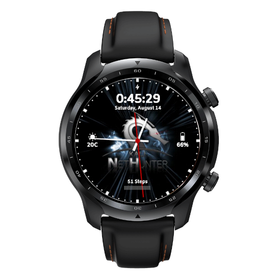

모든 버전(틱워치 프로 3 GPS/LTE/울트라 GPS/울트라 LTE)이 지원돼요.

# 포장 풀고 넷헌터를 실행하기 까지 6단계

1. 부트로더 언락
2. 기본 WearOS2로 되돌리기
3. TWRP, WearOS 이미지, Magisk, dm-verity disabler 플래시
4. 루팅 과정을 완료하기 위해 Magisk 앱 설정 마무리
5. 넷헌터 설치
6. 넷헌터 워치페이스 설정

## 1. 부트로더 언락하기

- 워치의 전원을 끄거나 재시작하세요
- 부트로더로 부팅하세요. 전원이 꺼진 상태 또는 재부팅 중에 부트로더 메뉴가 나타날 때까지 두 버튼을 누르세요
- DIY USB 케이블 또는 [3D 프린트 데이터 독](https://social.thangs.com/m/59021)을 사용하여 워치를 PC에 연결하세요
- `fastboot devices`를 실행하여 연결을 확인하세요
- `fastboot oem unlock`로 부트로더를 언락하세요
- 두 번째 버튼으로 yes를 선택하고 워치의 위쪽 버튼으로 확인하세요

## 2. 기본 WearOS2로 되돌리기

**이 단계는 워치가 WearOS 3가 설치된 경우에만 진행하세요.**

- 부트로더로 다시 부팅하세요.
- 순정 WearOS 2 ZIP 파일의 압축을 푸세요. (`ROVER_STOCK_FASTBOOT_PMRL.220704.001.zip` - LTE/Ultra LTE, `RUBYFISH_STOCK_FASTBOOT_PMRB.220703.001.zip` - GPS/Ultra GPS)
- Windows를 사용하는 경우 `flash_all.bat`을, 그 외 운영체제에서는 `flash_all.sh`를 실행하세요.
- 워치를 재부팅한 후, 데이터 포맷을 **필요한 경우에만** 승인하세요.

## 3. TWRP, OneOS 이미지, Magisk, dm-verify disabler 플래시

Magisk **24.3**이 권장돼요.
**OneOS**는 무선 인젝션을 사용할 때 권장돼요. 순정 WearOS에서는 재부팅 후 Nexmon 펌웨어나 라이브러리처럼 추가한 시스템 파일이 교체될 수 있어요.
**업데이트:** [apk0mix5900](https://github.com/apk0mix5900)의 Nexmon Magisk 모듈 덕분에 이제 순정 WearOS2도 지원돼요.

- 부트로더로 다시 부팅하세요
- vbmeta 인증 비활성화: `fastboot --disable-verity --disable-verification flash vbmeta vbmeta.img`
- `fastboot flash recovery recovery.img`로 리커버리를 플래시하세요
- 사이드 버튼으로 리커버리를 선택해 부팅하세요 (아래 버튼은 전환, 위 버튼은 선택)
- Wipe -> 다음 페이지 -> Advanced Wipe -> Format Data를 선택하세요
- 리커버리로 재부팅하세요
- "Install -> ADB Sideload"을 선택하세요
- 순정 WearOS를 유지하려면 다음 두 단계를 건너뛰세요
  - `adb sideload`로 OneOS를 플래시하세요
  - Mobvoi 앱 패키지를 `adb sideload`로 플래시하세요. 패키지 크기를 선택하며, 필수 앱만 원한다면 pico를 권장해요
- 울트라를 사용하는 경우, 울트라 애드온 패키지를 `adb sideload`로 설치하세요 (TWRP-OEM_FOR_TICWATCH_PRO_3_ULTRA(rover).zip - Ultra LTE, TWRP-OEM_FOR_TICWATCH_PRO_3_ULTRA_GPS(rubyfish).zip - Ultra GPS)
- `adb sideload Magisk-v24.3.apk`를 사용하여 Magisk를 플래시하세요

- `adb push Disable-DM-Verity_ForceEncrypt.zip /sdcard/`로 DM-Verity_ForceEncrypt Disabler를 복사 및 플래시 후 TWRP로 설치하세요
- 재부팅 & 초기 설정 수행 (WearOS 앱을 통해 휴대폰과 페어링)

## 4. 루팅을 완료하기 위해 Magisk 앱 설정 마무리

- 설정 -> 정보에서 OneOS/WearOS 버전을 여러 번 탭하여 개발자 설정을 잠금 해제하고 ADB를 활성화하세요
- 설정 -> 디스플레이에서 화면 시간 제한을 15로 설정하세요
- OneOS에서 앱 메뉴 버튼에 손이 닿을 수 있도록 `adb shell wm density 300`으로 밀도를 설정하세요
- Magisk 설치를 마치려면 `adb install Magisk-v24.3.apk`로 설치하세요
- Magisk 매니저를 여세요
- 오른쪽 상단 모서리에 있는 설정 버튼을 찾으세요 (찾기 조금 까다로워요)
- 자동 업데이트 비활성화를 원하면 자동 응답에서 권한을 설정하고, 향후 더 쉬운 탐색을 위해 토스트 알림을 비활성화할 수 있습니다

## 5. 넷헌터 설치

- 리커버리로 재부팅하세요
- Install -> ADB Sideload을 선택하세요
- `adb sideload`로 넷헌터 이미지를 플래시하세요
- `adb sideload`를 사용하여 Magisk apk를 다시 설치하세요
- 재부팅
- `adb push libnexmonkali.so /sdcard`로 libnexmonkali.so를 워치에 복사하세요
- adb 셸에서 `su -c 'cp /sdcard/libnexmonkali.so /data/local/nhsystem/kali-armhf/usr/lib/'`를 실행하여 chroot에 복사하세요
- 넷헌터 앱 & chroot를 시작하세요 (첫 실행 후 재부팅될 수 있어요)
- 모니터 모드와 워드라이빙은 **추가 추천 기능 및 앱** 항목을 참고하세요

## 6. 넷헌터 워치페이스 설정 (선택)

- 휴대폰의 Play 스토어에서 Facer 앱을 설치하세요
- WearOS용 Facer ZIP 파일의 압축을 해제한 후, `adb install-multiple *.apk`를 사용하여 포함된 APK를 설치하세요
- 휴대폰에서 넷헌터를 검색하세요
- 선택 & 동기화

## 업데이트 방법

- 새 앱 버전이 나오면 NetHunter Store에서 [최신 넷헌터 앱](https://store.nethunter.com/NetHunter.apk)을 다운로드하세요
- `adb install NetHunter.apk`로 업데이트하세요
- **Update Metapackages** 실행 중 패키지 변경 이력 화면에서 멈추면, 넷헌터 앱의 WearHunter 또는 PC에서 워치로 키 입력을 보낼 수 있어요. 예를 들면 다음과 같아요:
- 변경 이력 화면을 종료하려면 q 키 보내기: `adb shell input keyevent KEYCODE_Q`
- 패키지 관리자의 설정을 설치하려면 1 키 보내기: `adb shell input keyevent KEYCODE_1`
- ENTER 보내기: `adb shell input keyevent KEYCODE_ENTER`

### 틱워치 프로 3에서 칼리 넷헌터를 즐기세요

## 다운로드

- 빌드 파일:
  - [Magisk](https://kali.download/nethunter-images/devices/rubyfish/Magisk-v24.3.apk)
  - TWRP image for [rover](https://kali.download/nethunter-images/devices/rubyfish/rover_recovery.img) or [rubyfish](https://kali.download/nethunter-images/devices/rubyfish/rubyfish_recovery.img)
  - [vbmeta 이미지](https://kali.download/nethunter-images/devices/rubyfish/vbmeta.img)
  - [dm-verity disabler](https://kali.download/nethunter-images/devices/rubyfish/Disable-DM-Verity_ForceEncrypt.zip)
  - [OneOS, Stock ROMs, Ultra addon and Mobvoi packages](https://kali.download/nethunter-images/devices/rubyfish/) _(선택)_
  - [틱워치 프로 3 넷헌터 zip](https://www.kali.org/get-kali/#kali-mobile) - 아래로 스크롤하여 틱워치 프로 3을 찾으세요
  - [Facer app for WearOS 2](https://kali.download/nethunter-images/devices/rubyfish/facer_wearos.zip)
  - [libnexmonkali.so](https://github.com/yesimxev/nethunter_files/raw/refs/heads/main/twp3/libnexmonkali.so)

## 추가 추천 기능 및 앱

- [TotalCommander](https://www.totalcommander.ch/android/tcandroid323-armeabi.apk): Ducky script와 같은 항목을 선택할 때 유용하며, "adb install" 방법을 사용합니다
다운로드 링크: https://www.totalcommander.ch/android/tcandroid323-armeabi.apk
- Hijacker & Nexmon: [Magisk 모듈로](https://github.com/apk0mix5900/nexmon-twp3-magisk/releases/download/v1.2/nexmon-magisk-twp3-v1.2.zip) 또는 [수동으로](https://forums.kali.org/t/hijacker-on-ticwatch-pro-3-with-wireless-injection/6242) 설치하세요
- [워드라이빙](https://forums.kali.org/t/wardriving-on-ticwatch-pro-3-series/16422)
- [넷헌터 KeX](https://github.com/yesimxev/nethunter_files/raw/refs/heads/main/NetHunterKeX-watch.apk)

## 지원되는 기능
- 인젝션 기능이 있는 모니터 모드
- 칼리 서비스
- 커스텀 명령어
- 블루투스 Arsenal
- KeX
- MAC 변경
- HID 공격
- DuckHunter
- Nmap 스캔
- WPS 공격
- 워드라이빙

## 예정된 기능 (확정 아님)

- 넷헌터 터미널 키보드 호환성

- Router Keygen (최적화가 필요함)
- Mifare Classic Tool (android.hardware.nfc가 활성화된 OS를 빌드해야 함)

## 하드웨어 제한

- 전원 공급이 부족하여 외부 어댑터는 사용할 수 없습니다. 다만, 이 커널치 추후 Y 케이블을 지원할 가능성은 있습니다!
