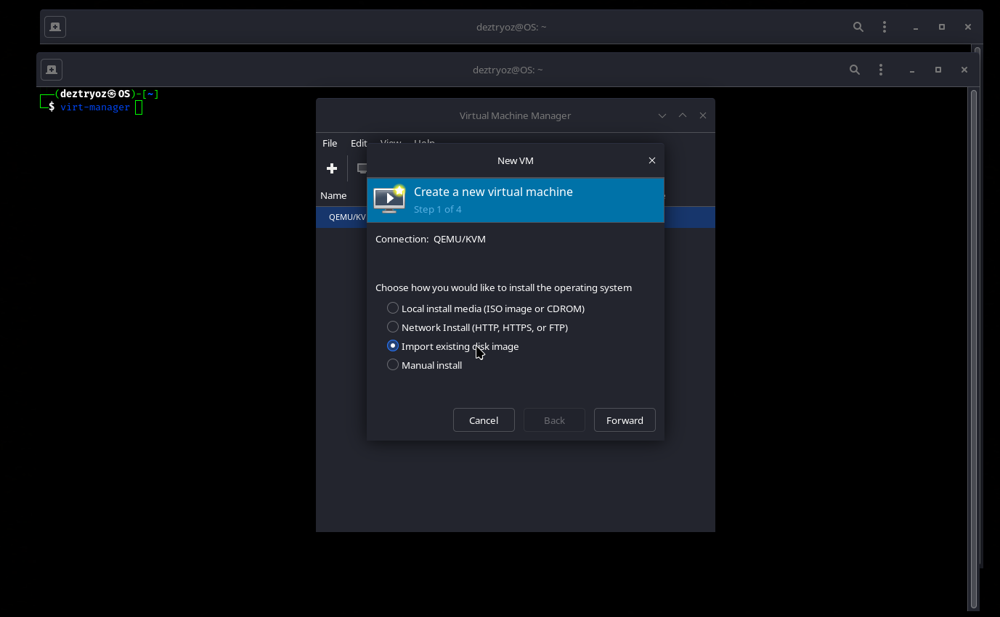
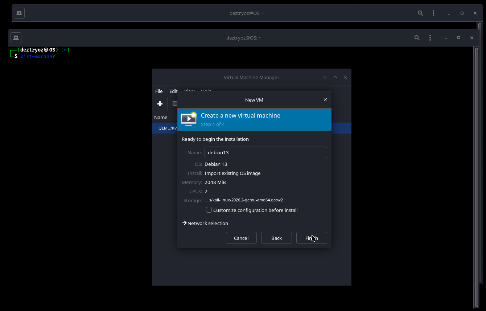

`virt-manager`를 사용하면 [Kali QEMU 이미지](/get-kali/#kali-virtual-machines)를 쉽게 가져올 수 있습니다.

먼저 다운로드한 QEMU 이미지의 압축을 풉니다:

```console
kali@kali:~$ 7z x kali-linux-<VERSION>-qemu-amd64.7z
[...]
kali@kali:~$
```

압축을 풀면 미리 생성된 Kali `.qcow2` 디스크 이미지가 추출됩니다.

`virt-manager`가 아직 설치되지 않았다면 다음 명령으로 설치합니다:

```console
kali@kali:~$ sudo apt update && sudo apt install virt-manager -y
[...]
```

이제 `virt-manager`를 실행하고 새 가상 머신을 생성합니다.

**기존 디스크 이미지 가져오기(Import existing disk image)**를 선택합니다:



압축을 풀어 얻은 Kali `.qcow2` 디스크 이미지를 선택합니다:


`virt-manager`에서 운영체제를 자동으로 감지하지 못한다면 자동 감지를 비활성화하고 적절한 Debian 버전을 직접 선택합니다:


가상 머신에 할당할 메모리와 CPU 코어 수를 지정합니다. 이 예시에서는 메모리 2GB와 CPU 코어 2개를 사용합니다:


가상 머신의 구성을 확인하고 필요하면 이름이나 기타 설정을 수정한 다음 설정을 완료합니다:



설정에 문제가 없다면 가상 머신 생성을 마치고 실행합니다.


미리 만들어진 Kali QEMU 이미지가 정상적으로 부팅될 것입니다. 기본 사용자 이름과 비밀번호는 모두 `kali`입니다.
